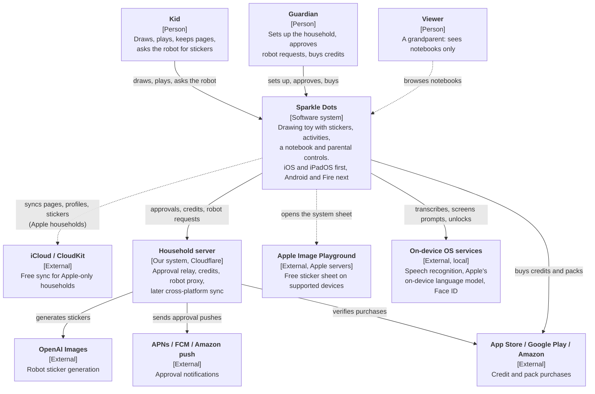

# 01 — System context (C4 level 1)

Who uses Sparkle Dots and which outside systems it depends on. Solid lines are always present. Dashed lines are optional paths that a household or device may not have.

## Notes

- **The household server is ours.** It's a Cloudflare Worker with a Durable Object per household, D1 and R2. It's only on the critical path for things that cost money (robot stickers, credits) and, later, for households that pay for cross-platform sync.
- **iCloud is free to us.** Data sits in the family's own iCloud and counts against their storage.
- **Image Playground runs on Apple's servers (Private Cloud Compute), not on the device.** It needs a network and an Apple Intelligence device, and Screen Time can block it. Apple discontinued the direct `ImageCreator` API in iOS 27, so the system sheet is the only way in.
- **On-device services never send a child's voice or prompt off the device.** That's a COPPA simplification as much as a cost one.
- **Viewers** (grandparents) are guardians with a read-only role. They need no app install if the web console exists, which is a later item.
