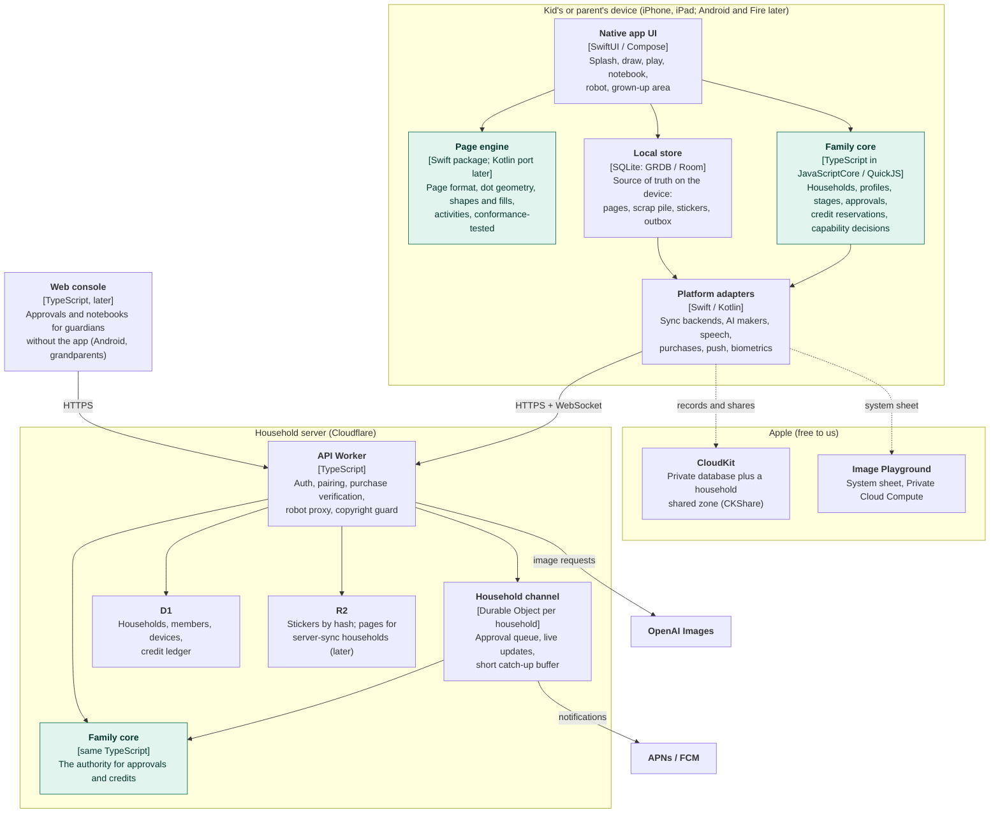

# 02 — Containers (C4 level 2)

The deployable and runnable pieces. The two cores are highlighted: the **page engine** (Swift, later Kotlin, held in sync by a shared conformance suite) and the **family core** (TypeScript, the same code everywhere).

## What runs where

| Container | Runs on | Owns | Needs network |
|---|---|---|---|
| Native app UI | Device | Screens and input, nothing else | No |
| Page engine | Device | The page format and everything computed from it | No |
| Family core (device copy) | Device, embedded JS engine | Policy decisions for instant UI | No |
| Local store | Device | All of the kid's data on that device | No |
| Platform adapters | Device | Talking to iCloud, the server, OS services | Some adapters |
| CloudKit | Apple | Sync for Apple-only households | Yes |
| API Worker | Cloudflare | Auth, pairing, purchases, robot proxy, server guard | — |
| Household channel | Cloudflare | Approval queue and live updates per household | — |
| D1 | Cloudflare | Households, members, devices, credit ledger | — |
| R2 | Cloudflare | Sticker images by hash; later, pages for paid sync | — |
| Family core (server copy) | Cloudflare | The authority for approvals and credits | — |
| Web console | Browser (later) | Guardian screens for people without the app | Yes |

## Rules

- **The device copy of the family core decides what the UI shows. The server copy decides what actually happens.** Anything involving credits is re-checked on the server.
- **The local store is the source of truth on each device.** iCloud and the server are sync peers, never the place the app reads from directly.
- **Nothing in the page engine knows about families, sync or AI.** It takes a page and produces geometry, fills and activity state.
- **Nothing in the family core knows about drawing.** It sees opaque page ids, sticker hashes and typed approval payloads, so other apps can reuse it.
