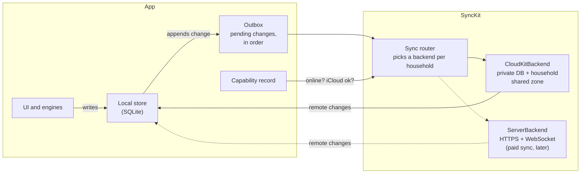
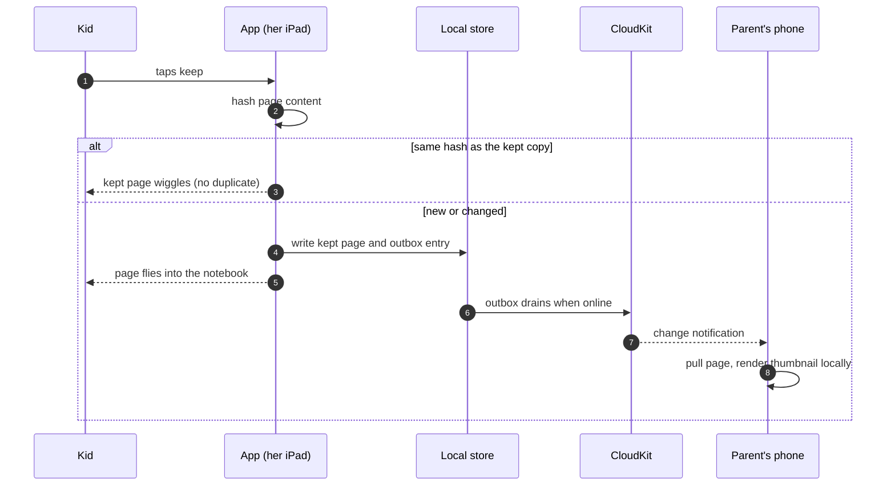
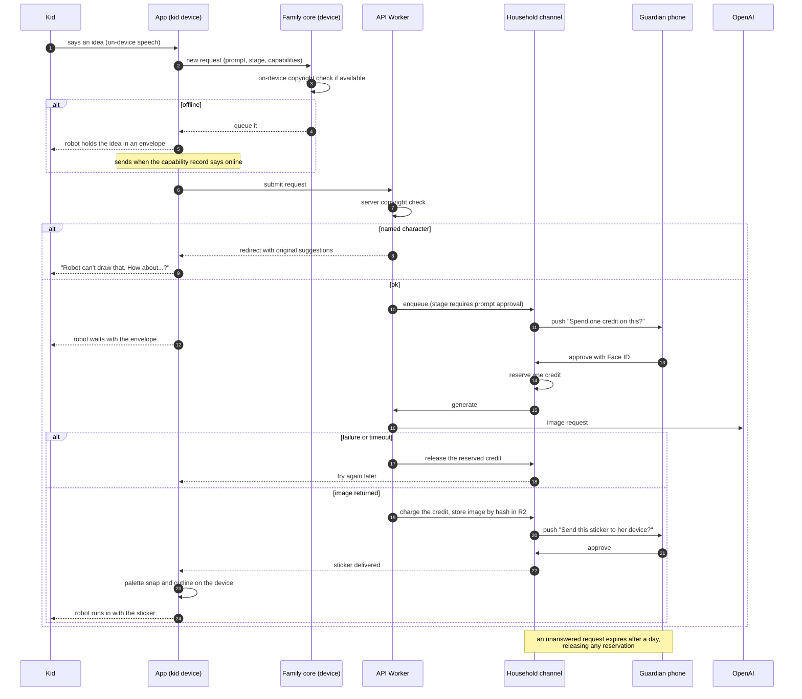
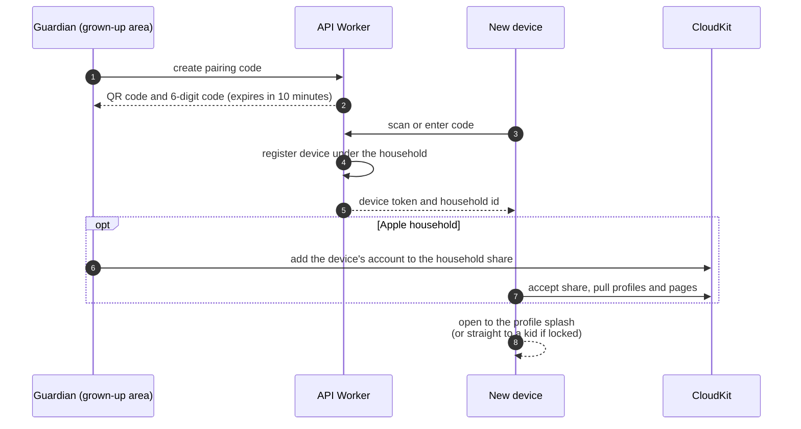

# 03 — Sync architecture

## What lives where

| Data | On device | iCloud (Apple households) | Household server | Notes |
|---|---|---|---|---|
| Working sheet (per kid) | Yes | Yes | Later, paid sync | Survives restarts; resumes on any device |
| Kept pages | Yes | Yes | Later, paid sync | Page data, a few KB each; thumbnails are never synced |
| Scrap pile | Yes | Yes, 30 days | Later, paid sync | Each device removes entries older than 30 days |
| Sticker images | Yes, cached | Yes, by hash | Robot stickers by hash | Stored once per household; pages refer to the hash |
| Profiles, stages, rail layouts | Yes | Yes | Mirror for approvals | Household-level; every profile works on every device |
| Household PIN | Hash only | Hash only | Hash only | Separate from any device passcode |
| Approval requests | Yes (log) | Apple-sheet approvals only | Robot approvals | One protocol, two transports (see below) |
| Credits | Display copy | Never | **Authority** | Reserved on approval, charged on success, refunded on failure |
| Activity log | Yes, full | Yes | Short catch-up buffer only | Guardians keep the log; the server only relays |
| Capability record | Yes, per device | Summary for parents | — | Live: network, iCloud, Apple Intelligence, credits, guardian reachability |

## Sync components on the device

- **Writes always land in the local store first.** The outbox drains when the capability record says the backend is reachable, oldest first, retrying with backoff.
- **One backend per household.** All-Apple households use CloudKit. Mixed households use the server once paid sync exists. Until then, a mixed household syncs between its Apple devices via iCloud, and Android devices keep data on the device.
- **Conflicts fork, never merge.** If one page changed on two devices before syncing, both versions are kept and the later one becomes a new page beside the original, so a kid never loses a drawing. The working sheet, which only one device should be drawing on at a time, uses last-writer-wins, and the losing version goes to the scrap pile instead of disappearing.
- **Thumbnails are rendered locally** from page data and cached by content hash. They never sync.
- **Sticker images sync by content hash**, so placing the same sticker on 50 pages stores it once.

## CloudKit layout (Apple households)

| Zone | Contents | Shared with |
|---|---|---|
| Household shared zone (CKShare) | Profiles, stages, rail layouts, PIN hash, sticker images, kept pages, working sheets, scrap pile, Apple-sheet approval records, log | Invited guardians and paired kid devices |
| Each guardian's private database | That guardian's own preferences | Nobody |

Guardians join by CloudKit share invitation, which works across any Apple accounts with no Family Sharing. A kid's iPad signed into a parent's or child Apple account joins the same share during pairing.

## Sequence: keeping a page (Apple household)

## Approvals: one protocol, two transports

The request and decision logic is the portable family core ([06](06-family-core.md)). Only delivery differs.

| Request type | Transport | Why |
|---|---|---|
| Robot prompt ("spend one credit on this?") | Household server relay | Spends credits, which only the server holds |
| Robot result ("send this sticker to her device?") | Household server relay | Same request, second stage |
| Apple-sheet result | CloudKit records in the household zone, with CloudKit push | Free; no credits involved |
| Grown-up door on a kid's device | Household server relay if reachable, PIN otherwise | Needs to be fast |

The shared test suite runs every approval case through both transports.

## Sequence: robot sticker with both approvals, including offline

## Sequence: pairing a new device

## Scrap pile expiry

Each device removes scrap-pile entries older than 30 days from its local store and from the household zone it can write to. Removal is idempotent, so two devices doing it at once is harmless. A sheet restored from the scrap pile becomes the working sheet and leaves the pile.
