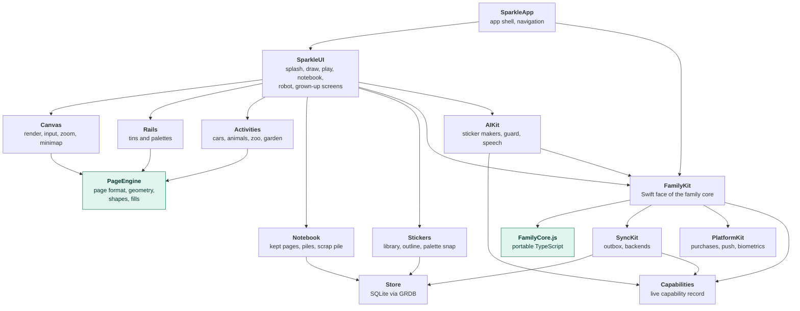

# 04 — iOS module contracts

The app is a thin shell over Swift packages. Each package has one job, a small public surface, and a list of things it may not depend on. The Android app mirrors the same boundaries in Kotlin modules.

## Dependency graph

Arrows point from a module to what it may use. Anything not drawn is forbidden.



## Contracts

The signatures are sketches of the public surface, not final code. Every module lists its **bans**: what it must never import or know.

### PageEngine (core, no dependencies)

Owns the page format and everything computed from it. Pure, deterministic, synchronous, testable headless with `swift test`.

```swift
public struct Page: Codable, Hashable {
  public var version: Int            // format version; old versions always load
  public var grid: GridSize          // the grid the page was born with
  public var lines: [DotLine]        // primitive lattice pieces
  public var fills: [FillSeed]       // raster seeds plus ink
  public var paint: [WashStroke]     // watercolor
  public var stickers: [PlacedSticker]  // sticker hash, position, scale, tilt
  public var activityState: [ActivityID: Data]  // opaque per activity
  public var reserved: [String: Data]   // room for papers and layers later
}
public protocol PageGeometry {
  func shapes(of page: Page) -> ShapeMap              // closed regions
  func lineGraph(of page: Page) -> LineGraph          // nodes and edges for activities
  func contentHash(of page: Page) -> PageHash         // for keep de-duplication
  func adding(_ line: DotLine, to page: Page, ink: Ink) -> Page  // fills newly closed shapes only
}
```

**Bans:** UIKit, SwiftUI, networking, FamilyKit, AIKit. **Witness:** the shared conformance suite (a folder of test drawings with expected shapes, fills and hashes) that the Kotlin port must also pass.

### Canvas

Draws a page and turns touches into page edits.

```swift
public protocol CanvasHost: AnyObject {
  var page: Page { get }
  func commit(_ edit: PageEdit)                       // undoable
  var zoom: ZoomState { get }                         // whole or close, plus pan offset
}
public enum ZoomState { case whole, close(center: CGPoint) }
```

Rules: one finger draws, two fingers pan (only when the page is bigger than the screen), plus and minus step the zoom, and the minimap shows only in close view. A second finger landing mid-line drops that line. **Bans:** notebook, family, AI.

### Rails

Tins (at most three per side) and their palettes, sized by the kid's stage.

```swift
public struct RailLayout: Codable { public var tins: [Tin]; public var selected: TinID }
public struct Tin: Codable { public var id: TinID; public var kind: TinKind; public var items: [RailItem] }
public enum TinKind { case colors, rainbows, watercolor, stickers(theme: String), activities }
public struct StagePreset { public var targetSize: CGFloat; public var colorCount: Int; public var stickerSlots: Int; public var showsTins: Bool }
```

In Play mode, the activities tin replaces the drawing tins. **Bans:** family, sync.

### Activities

One interface for every toy. Two shared engines sit underneath: one for things that run on lines, one for things that live in shapes.

```swift
public protocol Activity {
  static var id: ActivityID { get }
  var palette: [Tin] { get }                          // at most three tins
  mutating func start(page: PageSnapshot, state: Data?)
  mutating func update(dt: Double)
  func draw(in ctx: GraphicsContext, camera: Camera)
  mutating func touch(_ t: ActivityTouch)
  func savedState() -> Data?                          // garden growth, placed zoo animals
}
public struct PageSnapshot { public let graph: LineGraph; public let shapes: ShapeMap; public let stickers: [PlacedSticker] }
```

- **LineRunner engine:** cars (placed by the kid, slot-car controls: hold to speed up, too fast on a curve flies off) and animals (snail, turtle, rabbit, cheetah at their own speeds).
- **ShapeDweller engine:** zoo (animals wander inside the shape they're placed in) and garden (plant, water, grow; growth saved with the page).

Activities read a snapshot of the page and keep their own state; read-only is the default, not a hard rule. **Bans:** network, family, AI.

### Stickers

The household sticker library, stored by content hash.

```swift
public protocol StickerLibrary {
  func image(for hash: StickerHash) async -> StickerImage?   // local cache first
  func add(_ png: Data, source: StickerSource) throws -> StickerHash   // palette snap + outline applied first
  func tins(for stage: Stage) -> [Tin]                       // themed tins, robot tin when enabled
}
public enum StickerSource { case builtIn, pack(String), robot, applePlayground }
```

Stickers are shared freely among the household's kids. **Bans:** AI (makers hand finished images in), network.

### Notebook

Kept pages, piles and the scrap pile. It treats pages as opaque, versioned data, so the module is reusable by other apps.

```swift
public protocol NotebookStore {
  func keep(_ page: OpaquePage, kid: KidID) throws -> KeepResult   // .added, .updated, .unchanged (wiggle)
  func piles(kid: KidID, gap: TimeInterval) -> [Pile]               // grouped by gaps in time
  func scrap(_ page: OpaquePage, kid: KidID)                        // kept 30 days
  func restoreFromScrap(_ id: PageID) -> OpaquePage
}
public protocol PageRendering {   // supplied by the app
  func thumbnail(_ page: OpaquePage, size: CGSize) -> CGImage
  func open(_ page: OpaquePage)
}
```

**Bans:** PageEngine (it receives rendering through `PageRendering`), family, AI.

### FamilyKit (Swift face of the portable core)

Wraps `FamilyCore.js`, running in JavaScriptCore, behind Swift types. Supplies the core with the ports it needs (clock, storage, transport) and exposes decisions to the UI.

```swift
public protocol Family {
  var household: Household { get }
  var kids: [Kid] { get }
  func stage(for kid: KidID) -> Stage
  func preset(for kid: KidID, device: DeviceClass) -> StagePreset
  func request(_ r: ApprovalRequest) async -> ApprovalTicket       // queues offline
  func decide(_ id: ApprovalID, _ d: Decision) async throws         // guardians only, after unlock
  var credits: CreditDisplay { get }                                // display copy; server is the authority
  func unlockGrownUp(on device: DeviceRole) async -> UnlockResult   // Face ID, phone approval or PIN
  var notices: [GuardianNotice] { get }                             // quarter check-in, sync problems
}
```

**Bans:** drawing types. The core only ever sees page ids, sticker hashes and typed approval payloads.

### SyncKit

The outbox and the two backends ([03](03-sync.md)).

```swift
public protocol SyncBackend {
  func push(_ changes: [Change]) async throws
  func pull(since token: SyncToken?) async throws -> ([Change], SyncToken)
  var transportForApprovals: ApprovalTransport? { get }   // CloudKit records for Apple-sheet approvals
}
public final class CloudKitBackend: SyncBackend { }
public final class ServerBackend: SyncBackend { }        // paid cross-platform sync, later
```

**Bans:** UI, drawing types.

### AIKit

Every model-backed feature behind protocols, so the full experience and each fallback are interchangeable ([05](05-seams-fallbacks.md)).

```swift
public protocol StickerMaker { var availability: Availability { get }; func make(_ idea: String) async throws -> Data }
public protocol PromptGuard  { func check(_ idea: String) async -> GuardVerdict }
public protocol Transcriber  { var availability: Availability { get }; func transcribe() -> AsyncStream<String> }
public enum Availability { case ready, needsNetwork, unsupported, restricted, downloading, outOfCredits }
```

**Bans:** sending audio off the device. The only transcriber is on-device.

### Capabilities

One live record, read by everything.

```swift
public struct CapabilityRecord {
  public var network: NetworkState            // online, offline, constrained
  public var serverReachable: Bool
  public var iCloud: ICloudState              // available, signedOut, full
  public var appleIntelligence: AIState       // ready, unsupported, off, downloading
  public var playgroundAllowed: Bool          // Screen Time
  public var credits: Int?
  public var guardiansLastSeen: [GuardianID: Date]
}
```

### PlatformKit

StoreKit purchases (behind the grown-up unlock plus the store's own confirmation), APNs registration, LocalAuthentication, the Guided Access walkthrough. On Android: Play Billing or Amazon IAP, FCM or Amazon push, BiometricPrompt, screen pinning.

### Store

SQLite through GRDB. Tables for pages, scrap pile, stickers, outbox, approval log and preferences. Migrations are versioned and every one is tested on a database from the previous release.
