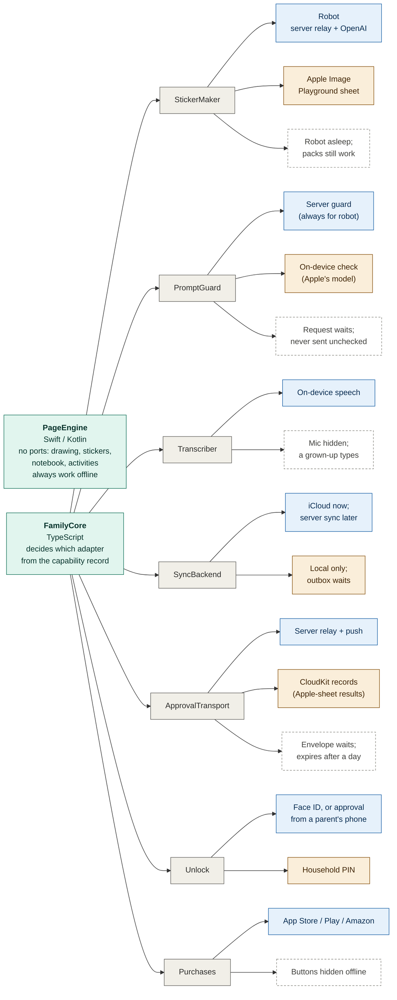
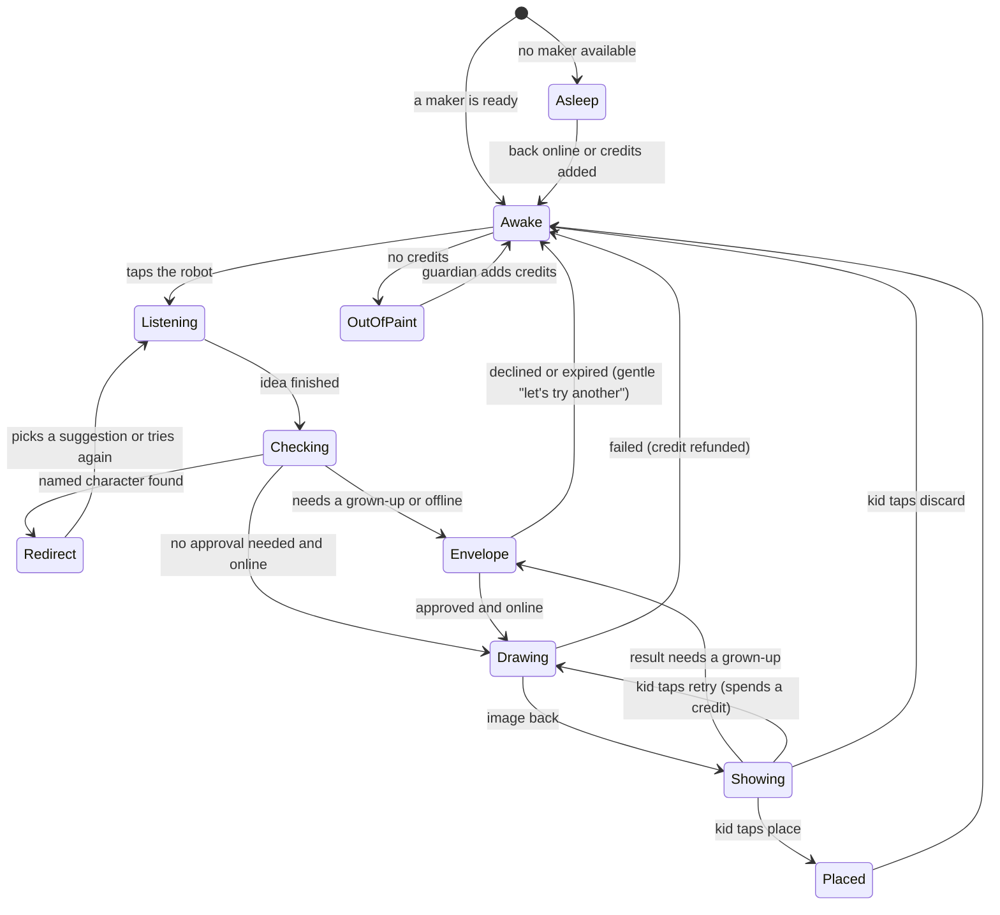
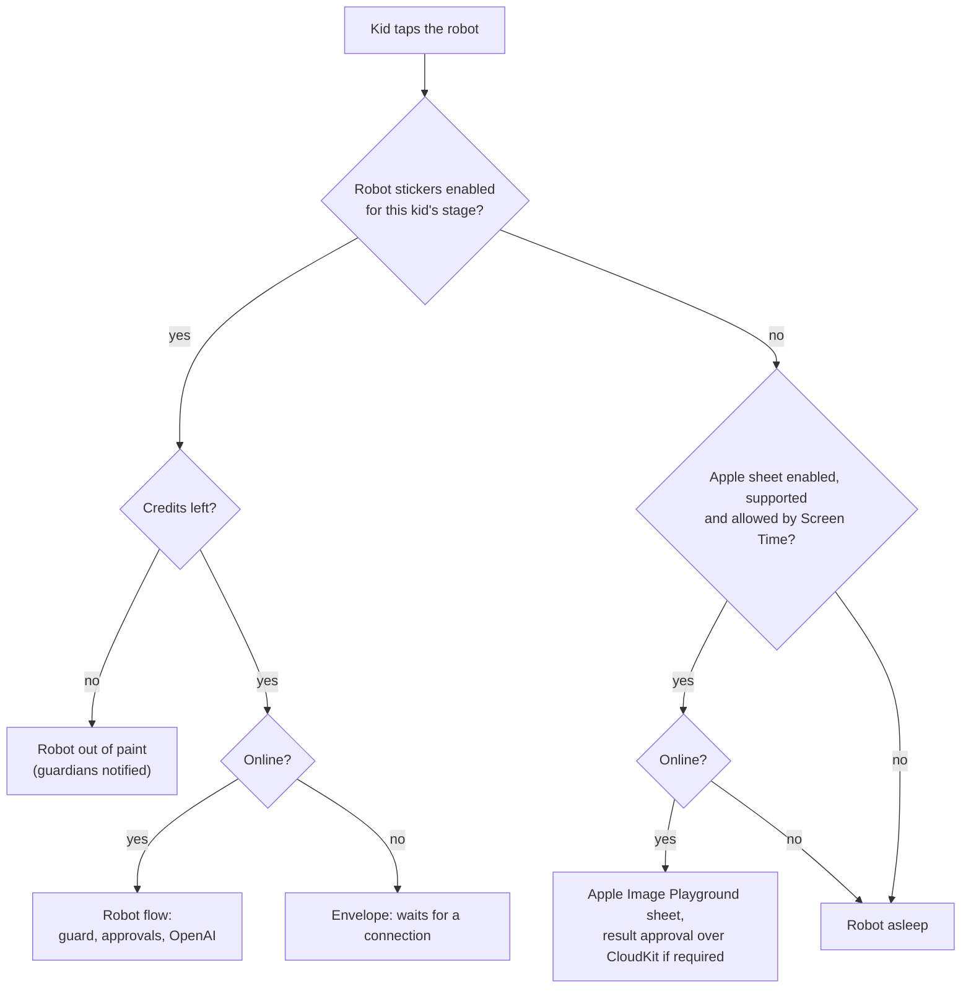

# 05 — Seams and fallbacks

Every feature that depends on something outside the app (a network, a server, Apple Intelligence, iCloud, credits) sits behind a port. The full experience and each fallback are adapters for the same port, chosen from the capability record. The cores sit in the middle and never know which adapter is plugged in.

## Where the cores live

Blue is the full experience, amber the fallback, dashed white what a kid or parent sees when neither is available.

The page engine has no ports at all: drawing, stickers, fills, the notebook and all four activities work with no network and no outside services.

## Capability-by-capability

| Capability | Full experience | Fallback | Nothing available | Who sees it |
|---|---|---|---|---|
| Sync | iCloud (Apple households); server sync later | Local store plus outbox; catches up later | Same: works entirely on the device | Parents see sync status |
| Approvals | Server relay, push, Face ID | CloudKit records (Apple-sheet stickers); same-phone approval with Face ID | Request waits in the envelope; expires after a day | Kid sees robot states |
| Making a sticker | Robot (credits, online, enabled) | Apple Image Playground sheet (device supports it, Screen Time allows it, enabled) | Robot asleep; drawn packs still work | Kid sees robot states |
| Copyright guard | Server guard (always, for robot) | On-device check first, where Apple Intelligence is ready | Request waits; never sent unchecked | Kid sees redirect suggestions |
| Voice | On-device speech | — (no server fallback, by design) | Mic hidden; a grown-up types | Kid sees mic or not |
| Grown-up door | Face ID (own phone) or approval from a parent's phone (kid device) | Household PIN | — | Guardians |
| Purchases | App Store, Google Play, Amazon | — | Purchase buttons hidden offline | Guardians |
| Big page on a small screen | Page fits at comfortable spacing | Plus and minus zoom, minimap, two-finger pan | — | Kid, only when needed |

## The robot: what a kid sees

Every AI outcome maps onto a handful of robot states, so a kid never sees an error.

Buttons follow the states: before an idea, **cancel** and **draw**. While drawing, **cancel** only. When a sticker comes back, **discard**, **retry** and a bigger **place**.

## Choosing a sticker maker

## Rules for the seams

1. **The core decides, the adapter delivers.** Adapters never contain policy. "Does this kid need approval?" is answered by the family core; the adapter only carries the request.
2. **Every port has a "nothing" outcome that the UI already knows how to show.** No adapter may throw an error that reaches a kid.
3. **Money only flows through the server adapter.** No fallback can spend or grant a credit.
4. **A child's voice never leaves the device.** The transcriber port has no network adapter.
5. **Capability changes are live.** When the record changes (back online, model finished downloading), the robot state and outbox react without a restart.
6. **Each fallback is tested by forcing the capability record.** The test suite runs the full approval and sticker flows with every combination of network, server, Apple Intelligence and credits.
