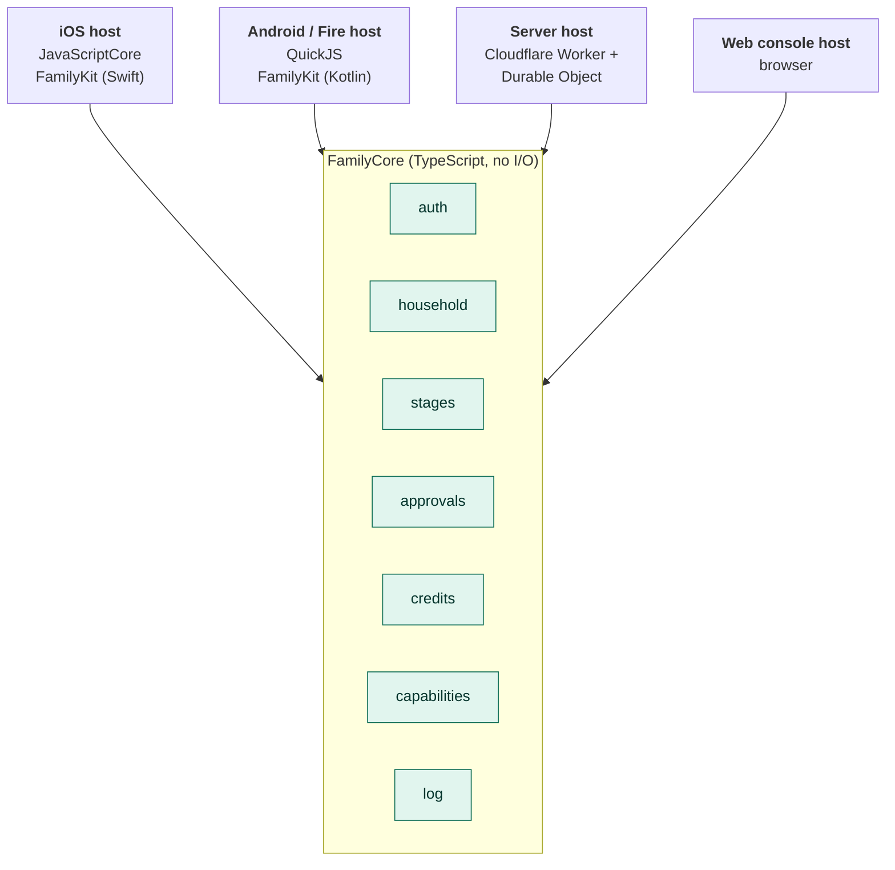

# 06 — Portable family core

Everything about households, accounts, approvals, stages and credits is written once, in TypeScript, and runs in four places: the iOS app, the Android and Fire app, the household server, and the web console. It holds policy and state machines only. Each host plugs in the I/O.

## Why TypeScript

| Option | For | Against | Verdict |
|---|---|---|---|
| **TypeScript** | Runs natively in Cloudflare Workers and browsers; JavaScriptCore is built into iOS; QuickJS or Hermes embed small on Android | A JS engine inside native apps; async across the bridge | **Chosen.** The server is the authority, and it's TypeScript already |
| Kotlin Multiplatform | Native on Android, compiles for iOS | No good Workers story; second language on the server | No |
| Rust | Native everywhere, WebAssembly for Workers | Heavy toolchain for what is mostly rules and state machines | No |

The page engine stays native (Swift, then Kotlin) because drawing feel is the product. The family core is rules and bookkeeping, where a shared language matters more than native speed.

## Hosts



## Modules

| Module | Owns | Authority |
|---|---|---|
| **auth** | Account identities (Sign in with Apple, Google, email with passkey), sessions and device tokens, the role and permission matrix (owner, guardian, viewer, kid device), pairing-code rules, PIN rules and attempt limits, the unlock policy per device role | Server issues and verifies tokens; devices apply the same policy for instant UI |
| **household** | Households, members, kid profiles (nickname, avatar, birth year and quarter), devices, "always open as" locks | Server for membership; iCloud or server sync for the rest |
| **stages** | Little, middle, older; the preset each stage implies per device class (dot spacing, target size, colors, sticker slots, which AI features can be turned on); the quarter notice | Shared rules; guardians decide |
| **approvals** | The request and decision state machine for every request type, expiry, which stage needs which approval | Server for robot requests; CloudKit-carried for Apple-sheet results |
| **credits** | Reserve on approval, charge on success, release on failure or expiry; balance display rules | **Server only.** Devices hold a display copy |
| **capabilities** | Turning the device's capability record into decisions: which sticker maker, which robot state, whether to show the mic | Device |
| **log** | Event schema for the guardians' log; what the server keeps (a short catch-up buffer) and for how long | Devices keep the log; the server only relays |

### Auth in more detail

The sign-in screens themselves are native (AuthenticationServices on iOS, Credential Manager on Android, a standard web flow in the console). They hand an identity token to the server. Everything after that is the core's:

- **Roles and permissions:** one table, used by the server to enforce and by apps to decide what to show.

| Action | Owner | Guardian | Viewer | Kid device |
|---|---|---|---|---|
| Approve robot requests | yes | yes | no | no |
| Buy credits and packs | yes | yes | no | no |
| Change stages and AI settings | yes | yes | no | no |
| Pair or remove devices | yes | yes | no | no |
| Invite guardians and viewers | yes | no | no | no |
| See notebooks and the log | yes | yes | notebooks only | own kid only |
| Ask the robot | no | no | no | yes, by stage |

- **Pairing:** 6-digit codes and QR payloads, single use, 10-minute expiry, rate limited per household.
- **Household PIN:** hashed with a salted, slow key-derivation function through the host's crypto port; five wrong tries locks it for a growing interval; usable only on devices paired to the household.
- **Unlock policy:** own phone → system biometrics or passcode; kid device → approval from a guardian's phone if the server is reachable, otherwise the PIN.

## The bridge contract

The core is a pure function of state and messages. Hosts send commands and inputs and receive effects to perform. Every message is plain JSON and carries a schema version.

```ts
// what a host sends in
type Input =
  | { kind: 'command'; cmd: Command }              // e.g. newApprovalRequest, decide, setStage
  | { kind: 'event'; event: ExternalEvent }        // e.g. serverAck, pushReceived, capabilityChanged
  | { kind: 'tick'; now: number }                  // the host owns the clock

// what the core hands back
type Output = {
  state: FamilyState                               // serializable; the host persists it
  effects: Effect[]                                // the host performs these
  view: ViewModel                                  // what the UI should show right now
}

type Effect =
  | { kind: 'send'; to: 'server' | 'cloudkit'; message: WireMessage }
  | { kind: 'persist'; key: string; value: unknown }
  | { kind: 'notify'; guardianIds: string[]; notice: Notice }
  | { kind: 'hash'; purpose: 'pin'; input: string; salt: string }   // crypto via host port
  | { kind: 'schedule'; at: number; reason: string }

export function step(state: FamilyState, input: Input): Output
```

### Ports each host provides

| Port | iOS | Android / Fire | Server | Web |
|---|---|---|---|---|
| Clock | `Date` via tick | via tick | request time | via tick |
| Storage | Local store (GRDB) | Room | D1 / Durable Object storage | IndexedDB |
| Transport | URLSession, WebSocket, CloudKit | OkHttp, WebSocket | — | fetch, WebSocket |
| Crypto | CryptoKit | Android keystore / JCA | WebCrypto | WebCrypto |
| Push | APNs | FCM / Amazon | sends pushes | Web Push |

## Rules

1. **No I/O inside the core.** No `fetch`, no timers, no storage, no `Date.now()`. Hosts pass time in and perform effects.
2. **Deterministic.** The same state and inputs always give the same outputs, so the server can replay a device's request and agree with it.
3. **Versioned schemas.** Every state and wire message carries a version. A newer core reads every older version; the server accepts the previous app version's messages for at least one release cycle.
4. **One set of test vectors.** A folder of scenario files (input sequences and expected outputs) runs against the core in Node, in JavaScriptCore on an iOS simulator, in QuickJS on Android, and in the Workers runtime. A host passes only if it reproduces every vector.
5. **No drawing concepts.** The core sees page ids, sticker hashes and typed payloads (`stickerPrompt`, `stickerResult`, `applePlaygroundResult`, `grownUpUnlock`). Another app can add payload types without touching existing ones.
6. **Small.** The bundle is budgeted (target under 200 KB minified) so starting the JS engine doesn't slow app launch. The kid's drawing screen never waits on it: the splash and the drawing surface come up from native state while the core loads in the background.
