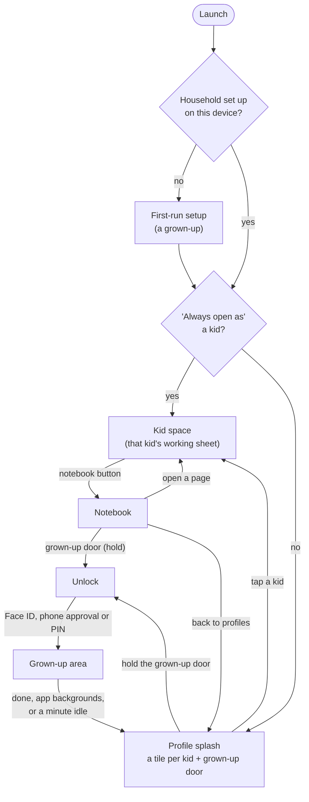
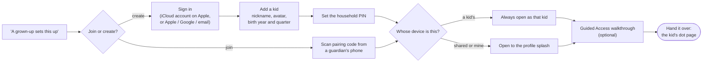
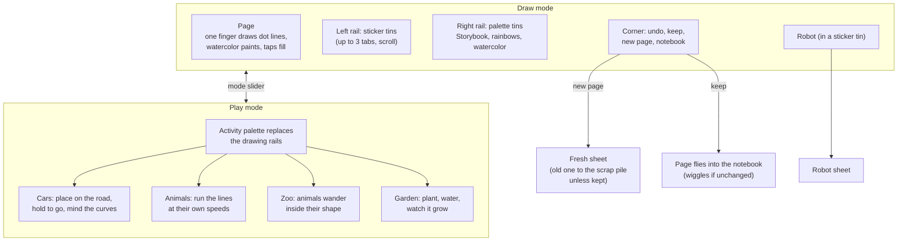
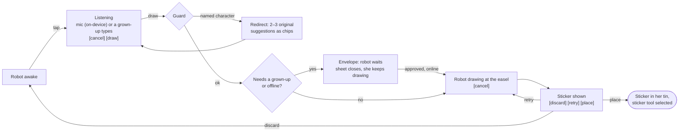
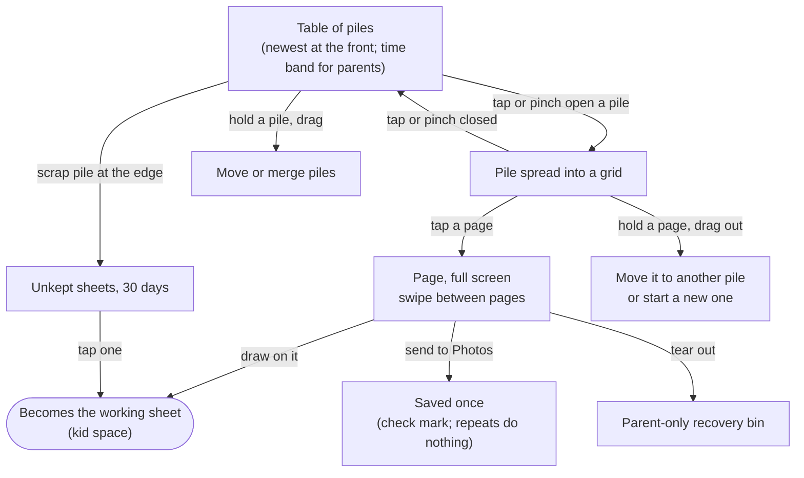
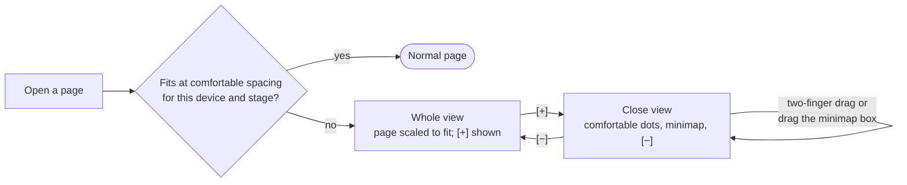
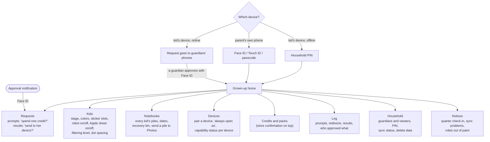
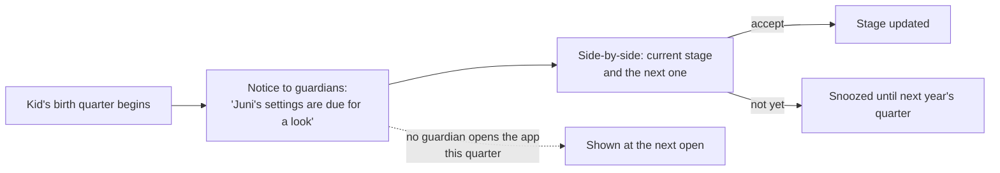

# 07 — Screen flows

Every mode of the app, from first launch to the grown-up area. iPad and iPhone share the same flows; layout differences are listed at the end.

## App map

## First-run setup (a grown-up)

## Kid space: Draw and Play

The mode slider along the top switches between Draw and Play. The rails swap with it; the page stays.

- **Keep** stays in the same spot at every stage and never moves into a tin.
- **New page** never asks anything. An unkept sheet goes to the scrap pile, and undo right afterward brings it back.
- **Play mode** saves activity state with the page (garden growth, where zoo animals live).

## Robot sticker sheet

## Notebook

## Big page on a smaller screen (fallback only)

## Grown-up area

### Filtering levels (per kid, set in Kids)

| Level | Robot prompt | Robot result | Apple sheet result |
|---|---|---|---|
| Strictest (default for little) | Guardian approves ("spend one credit?") | Guardian approves ("send to her device?") | Guardian approves |
| Middle | Sent automatically if it passes the guard | Guardian approves | Sent automatically |
| Open | Automatic | Automatic | Automatic |
| Off | Robot hidden | — | Sheet hidden |

The log records everything at every level.

### Quarter check-in

## iPad and iPhone layouts

| | iPad (landscape) | iPhone (landscape) | iPhone (portrait) |
|---|---|---|---|
| Rails | One per side: stickers left, palettes right | One per side, narrower | One strip along the bottom |
| Tins | Above each rail | Above each rail | At the start of the strip |
| Corner buttons | Top right | Clustered in one corner | Top row |
| Mode slider | Top center | Top center | Top |
| Dots | Comfortable spacing for the stage; about 14 × 12 at middle | About 14 × 8 at middle; more on a Pro Max | Rotated grid |
| Grown-up area | Split view | Standard stacked navigation | Standard stacked navigation |
